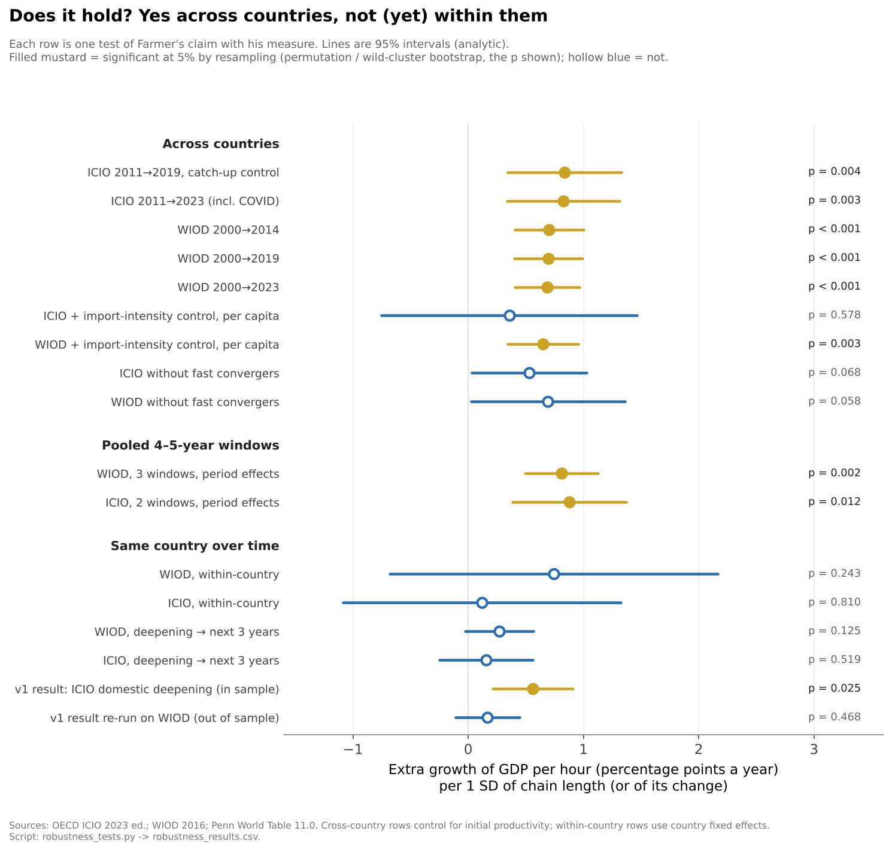
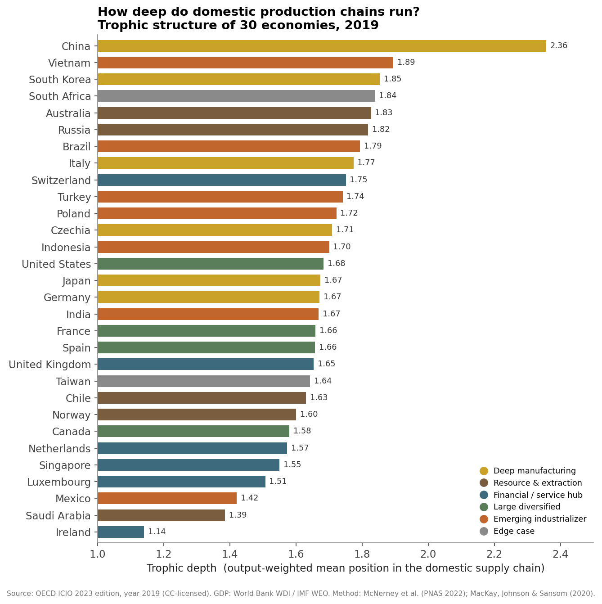

# Trophic structure of economies — *Il Divano Color Senape*

How deep do a country's production chains run? This project measures the **trophic
structure** of 30 economies from public input-output data and turns it into four
publication-ready figures. Inspired by J. Doyne Farmer, *Making Sense of Chaos* (2024).



## v2 (November 2026): two hypotheses

This study tests two hypotheses about production chains and growth:

- **H1 (Farmer / McNerney et al.)**: economies with **longer** production chains grow
  faster, because productivity gains compound along every chain. Where the production
  steps happen doesn't matter.
- **H2 (this study)**: **where** the steps happen also matters. The part of the chain
  located **at home** should predict growth beyond total length, because GDP counts
  domestic production and domestic steps build domestic capabilities.

To test H2, each country's chain length is split exactly into **steps at home** and
**steps abroad** (same weights for both; they add up to Farmer's measure). In 2019 Italy's
chains count 2.02 steps: 1.71 at home + 0.31 abroad. Ireland's: 1.15 at home + 0.76
abroad.

v1 measured depth differently from the paper it was testing. McNerney, Savoie,
Caravelli, Carvalho & Farmer (PNAS 2022) solve the **whole world** input-output table
and average each country's industries by their **final-demand** shares. v1 cut chains
at the national border and weighted by gross output. The weights barely matter, but the
border does: on the same 2019 data the two rankings have a rank correlation of only
0.45 (figure 9). Ireland moves from last to 22nd, Luxembourg from 27th to 2nd.

v2 makes the paper's definition the headline (`measures.py`) and keeps v1's domestic
depth as a secondary metric ("how much of the chain sits at home"). Then it tests the
growth claim harder than v1 did:

- a **second, independent database**: WIOD 2016 release, 43 economies, 2000–2014 (the
  database family the paper used);
- growth measured as **real GDP per hour worked** (Penn World Table 11.0), the paper's
  outcome. v1 used total GDP, which mixes in population growth;
- horizons up to 23 years, with **permutation and wild-cluster-bootstrap p-values**,
  because there are only 30–43 countries;
- controls for catch-up and for **reliance on imported inputs**, and a run **without the
  fast convergers** (China, Vietnam, EU members since 2004);
- the paper's other prediction, that **prices fall faster at the end of long chains**,
  tested on 2,224 industries.

| Question | Answer |
|---|---|
| Do countries with longer chains grow faster? | **Yes, in both databases and at every horizon.** After controlling for catch-up: +0.7 to +0.8 percentage points a year of GDP-per-hour growth per standard deviation of chain length, p ≤ 0.004. Raw correlation 0.63–0.66 (the paper reports 0.53 for 1995–2009). |
| ...with v1's domestic measure? | Much weaker: +0.16 on ICIO (p = 0.77), +0.42 to +0.50 on WIOD (p = 0.04–0.08). v1's "the naive version fails" was mostly the measure. |
| ...after controlling for imported inputs? | Yes on WIOD (p ≤ 0.005). No on ICIO (p = 0.12–0.61). Long chains and supply-chain integration are hard to separate with 30 countries. |
| ...without China, Vietnam and the post-2004 EU members? | About as large (+0.5 to +0.7), but with fewer countries only borderline significant (p = 0.05–0.09). |
| Does a country grow faster after **its own** chains lengthen? | **Not detectably.** Within-country estimates are noisy (p = 0.24, 0.81). v1's "deepening" result (p = 0.025 in its own sample) does not replicate on WIOD (p = 0.47). |
| Is it the chains, or faster industries inside them? | **Mostly the chains.** Long-chain economies also had faster-improving industries (r = 0.43), which explains about 26% of the cross-country slope; the rest remains (p < 0.001). A zero-parameter forecast, chain length (2007) × industry productivity growth (2000–07), predicts 2007–14 growth slightly better than benchmarks (correlation 0.64 vs 0.55 without chain-length differences and 0.62 for "past growth continues"). See figure 13 and `amplification_tests.py`. |
| **H2: does a step at home count more than a step abroad?** | **No detectable difference.** Both halves predict growth by similar amounts (WIOD: home +0.74 to +0.80 per SD, abroad +0.56 to +0.58, both p ≤ 0.002). Holding total length fixed, more of it at home adds little: a home step is worth an estimated 19–32% more than a generic step in WIOD, but the 95% interval (−35% to +81%) includes zero, and the home coefficient is never significant (p = 0.24–0.93). Measuring only the home half misses a part that predicts growth just as well, which is why v1's domestic measure looked weak. See figure 14 and `hypotheses_tests.py`. |
| Do prices fall faster at the end of long chains? | **Between industry types, yes** (−0.27 points a year per SD, p < 0.001), and the decline comes with the stages **abroad** (−0.29, p < 0.001), not those at home (p = 0.42): industries get cheaper as their foreign suppliers improve. For the **same industry in different countries, no** (p = 0.70). |

**Bottom line.** H1, Farmer's cross-country pattern, replicates on two databases, with
the paper's own outcome, and survives most of the checks a sceptic would throw at it. On
H2, steps abroad count about as much as steps at home: no detectable premium for location,
though a moderate one can't be ruled out with 30–43 countries. What this data can't show
is the causal step: that lengthening a country's chains, at home or abroad, *makes* it grow
faster, rather than long chains marking the kind of economy that grows.

All numbers come from `robustness_tests.py` → `robustness_results.csv` (55 estimates,
fixed random seed) and `amplification_tests.py` → `amplification_results.csv`,
`forecast_results.csv`, and `hypotheses_tests.py` → `hypotheses_results.csv` (H2).
Figures 9–14 show the re-ranking, the replication, every test on one scale, the price
mechanism, composition vs amplification, and steps at home vs abroad. The network figures
(8 and `figures/networks/`) now draw both halves of every chain.

**Paper.** The full write-up is a working paper: [`paper/main.pdf`](paper/main.pdf),
*"Do Longer Production Chains Make Economies Grow Faster, and Does It Matter Where the
Chain Is? A replication of the production-network amplification hypothesis and a test of
the role of location"* (draft v0.2). Every number
in it is generated from the result files by `paper/make_numbers.py`.

> **Correction to v1.** The README previously said trophic level "equals the row sums
> of the Leontief inverse". The code computes `(I − Aᵀ)⁻¹ 1`, the **column** sums (the
> output multiplier), which is what the paper uses. The code was right; the text is now
> fixed. v2 also stops the `OUT` total from slipping into the global sector list. This
> was harmless before (its own cell is zero), and v1's outputs regenerate byte-identical.



## The idea

Ecologists rank species by *trophic level*: plants sit at the bottom, herbivores one
step up, their predators above them. The same arithmetic works on an economy's
input-output table. An industry that runs mostly on labour and raw materials sits low;
an industry fed by long chains of *other* producers sits high. Average a country's
industries and you get its **trophic depth** — a one-number summary of how long its
production chains are. Farmer's group showed this is not idle structure: deeper chains
predict faster long-run growth.

We compute two versions:

- **Domestic trophic depth** — chains *inside* the country only.
- **Global trophic depth** — chains including imported intermediates (a country's true
  position in global value chains).

Their difference is the **offshore gap**: how much of a country's production depth is
actually assembled abroad. It cleanly separates self-contained giants (China, the USA)
from assembly-and-holding economies (Vietnam, Ireland, Luxembourg, Singapore).

## Method

- **Trophic level = output multiplier** (McNerney, Savoie, Caravelli, Carvalho & Farmer,
  *PNAS* 2022): a sector's level is `1 +` the input-share-weighted average level of its
  suppliers, with value added as the implicit base. Equals the column sums of the Leontief
  inverse, `(I − Aᵀ)⁻¹ 1`. → `trophic.py:trophic_levels_io`
- **v2 country depth** (the paper's eq. 5): the same multipliers solved on the **world**
  table, averaged with **final-demand** weights. → `measures.py:world_measures`
- **Trophic incoherence** (MacKay, Johnson & Sansom, *Royal Society Open Science* 2020):
  how cleanly the flow network layers vs. how tangled it is. → `trophic.py:trophic_incoherence`

Both functions are validated against networks with known answers — run `python3 trophic.py`.

## Data & provenance

| What | Source | Licence |
|---|---|---|
| Input-output tables | **OECD ICIO, 2023 edition, year 2019** (regular/SML, ISIC Rev.4, 76 economies) | OECD terms of use (free reuse w/ attribution) |
| GDP, GDP per capita, growth | **World Bank** World Development Indicators | CC BY 4.0 |
| Taiwan macro figures | **IMF** World Economic Outlook | per IMF terms |
| Input-output tables, v2 replication | **WIOD 2016 release** (Timmer, Dietzenbacher, Los, Stehrer & de Vries 2015): 43 economies × 56 industries, 2000–2014, plus Socio-Economic Accounts (prices, wages). [doi:10.34894/PJ2M1C](https://doi.org/10.34894/PJ2M1C) | CC BY 4.0 |
| GDP per hour worked (v2) | **Penn World Table 11.0** (Feenstra, Inklaar & Timmer): `rgdpna` for growth, `rgdpo` (PPP) for the catch-up level, `emp × avh` for hours. [doi:10.34894/FABVLR](https://doi.org/10.34894/FABVLR) | CC BY 4.0 |

The raw ICIO CSVs (~66 MB/year) are **not** committed — run `bash download_data.sh` to
fetch them. The newest **2025 edition** (data to 2022) is a drop-in upgrade; see the
script and the OECD page linked there.

> Year 2019 is used deliberately: it is the last pre-pandemic year, so the structure
> isn't distorted by COVID-19 shocks to 2020 input-output flows.

## Reproduce

```bash
pip install -r requirements.txt
bash download_data.sh            # fetch OECD ICIO (2011-2020) into icio2023/

# --- cross-section (one year) ---
python3 trophic.py               # self-tests
python3 build_trophic.py         # -> results_country.csv, results_sectors.csv
python3 fetch_gdp.py             # -> gdp_context.csv  (needs internet)
python3 make_figures.py          # -> figures/1..4 .png

# --- dynamic test (panel) ---
python3 build_panel.py icio2023/20{11,12,13,14,15,16,17,18,19,20}_SML.csv  # -> panel.csv
python3 fetch_growth.py          # -> growth_panel.csv  (needs internet)
python3 dynamic_test.py          # prints the regression table -> dynamic_sample.csv
python3 make_dynamic_figures.py  # -> figures/5..7 .png

# --- network visualizations ---
python3 network_viz.py DEU SAU   # a contrast pair  -> figures/8_network_DEU_SAU.png
python3 network_viz.py --all     # all 30, one file each -> figures/networks/<CODE>.png
python3 montage_networks.py      # contact sheet -> figures/networks_contact_sheet.png
python3 build_album.py           # one-per-page PDF -> figures/trophic_networks_album.pdf

# --- structural descriptors + insights ---
python3 analyze_networks.py      # -> network_descriptors.csv (+ correlations printed)

# --- v2: does it hold? ---
python3 measures.py              # self-tests for the new measures
python3 build_icio_v2.py icio2023/20{11,12,13,14,15,16,17,18,19,20}_SML.csv  # -> icio_country_year.csv
bash download_wiod.sh            # WIOD 2016 release -> wiod_data/ (~640 MB download)
python3 build_wiod.py            # -> wiod_country_year.csv, wiod_industry_2000.csv
python3 fetch_pwt.py             # Penn World Table 11.0 -> pwt_growth.csv (needs internet)
python3 robustness_tests.py      # -> robustness_results.csv, price_test_sample.csv (~5 min)
python3 build_productivity.py    # industry productivity growth -> wiod_gamma.csv, wiod_amplification.csv
python3 amplification_tests.py   # -> amplification_results.csv, forecast_results.csv
python3 hypotheses_tests.py      # H1 vs H2: steps at home vs abroad -> hypotheses_results.csv (~5 min)
python3 make_v2_figures.py       # -> figures/9..14 .png

# --- the paper ---
python3 paper/make_numbers.py    # -> paper/numbers.tex, paper/tables/*.tex
(cd paper && latexmk -pdf main.tex)   # -> paper/main.pdf

# --- rebuild the interactive dashboard ---
npm install d3                   # one-off: provides D3 to inline
python3 export_web_data.py       # -> docs/data.json
python3 build_dashboard.py       # inlines D3 + data -> docs/index.html
```

Every step above was verified end-to-end from a fresh clone: `results_country.csv`,
`panel.csv`, and `network_descriptors.csv` regenerate **byte-identical** to the
committed copies, and all figures, the album, and the dashboard rebuild cleanly.

## Interactive dashboard (GitHub Pages)

`docs/index.html` is a fully self-contained network explorer — pick any country, see its
trophic network rendered live, hover sectors, and click the ranking/offshore-gap charts
to cross-navigate. It embeds both its data **and** the D3 library, so the single file
works offline with no internet connection or external dependencies.

Rebuild it after changing the data:

```bash
npm install d3                 # one-off: provides the D3 library to inline
python3 export_web_data.py     # -> docs/data.json
python3 build_dashboard.py     # inlines D3 + data -> docs/index.html
```

**Publish on GitHub Pages:** push the repo, then in *Settings → Pages* set
*Source = Deploy from a branch*, *Branch = main*, *Folder = /docs*. Your explorer goes
live at `https://<user>.github.io/<repo>/`. (You can also just double-click
`docs/index.html` to open it locally — it works offline.)

## The dynamic test (v1) — does Farmer's claim actually hold?

> **Superseded by v2 (see the top of this page).** This section used v1's domestic
> measure and total GDP growth. With Farmer's measure and GDP per hour, the
> cross-country claim holds. The "deepening" result below does not replicate on a
> second database. The v1 text is kept for the record.

Farmer argues deeper production chains *cause* faster growth. A single year can't
test that, so we built a **10-year panel** (trophic depth × 30 countries, 2011–2020)
and asked whether depth predicts *subsequent* 3-year GDP growth. Standard errors are
clustered by country.

| Specification | Effect of depth on next-3-yr growth | p |
|---|---|---|
| Raw correlation | +1.3 | 0.64 |
| + catch-up control (income level) | −0.7 | 0.82 |
| + year fixed effects | −0.7 | 0.82 |
| **Within-country** (country fixed effects) | **+4.3** | 0.25 |
| **Deepening** (Δdepth over prior 3 yrs) | **+8.7** | **0.09** |

The naive "deeper economies grow faster" **fails** — it's an artifact of where countries
sit, and it vanishes once you control for catch-up. But the *dynamic* version Farmer
actually makes survives: **when a country deepens its own chains, it tends to grow faster
afterward** (marginally significant, p≈0.09). Suggestive, not conclusive, on a short
panel — but pointing his way. See `figures/5–7`.

> Honest caveats: 10 years is short for a long-horizon claim; depth is persistent so
> windows overlap; 29 countries (Taiwan dropped — no World Bank series); marginal
> significance. A multi-decade panel (older ICIO bundles, fetched manually) is the
> natural strengthening.

## What the figures show

1. **`1_depth_ranking.png`** — trophic depth, ranked. China deepest (2.36); Ireland
   shallowest (1.14) — its multinational-inflated output barely chains domestically.
2. **`2_offshore_gap.png`** — domestic vs global depth. China and the USA hug the
   diagonal (self-contained); Vietnam, Luxembourg, Ireland and Singapore float far above
   it (their chains live abroad).
3. **`3_trophic_profiles.png`** — the full distribution of output across trophic levels
   for eight economies. Saudi Arabia's mass sits low; China's and Czechia's sit high.
4. **`4_depth_vs_growth.png`** — Farmer's claim, tested loosely on the cross-section
   (r ≈ 0.34), with the catch-up confound shown via bubble size. The *proper* test is
   the panel below.
5. **`5_depth_trajectories.png`** — how each economy's trophic depth moved 2011–2020.
   Vietnam deepened sharply; China rose then partly reversed; mature economies sat flat.
6. **`6_deepening_vs_growth.png`** — *(v1; does not replicate in v2)* the key result: countries that deepened their chains
   then grew faster.
7. **`7_specification_curve.png`** — *(v1; superseded by figure 11)* the honesty plot: the growth link appears *only* in
   the dynamic, within-country specifications, not the naive correlation.
8. **`8_network_DEU_SAU.png`** — the production network itself, Farmer-style, showing both
   halves of every chain. Height = production stages behind each sector, counting steps
   abroad; the hollow dot below each node = stages at home only (the dashed line between
   them = steps abroad). Fill = share of inputs imported; size = gross output; ring =
   production community (colours have no fixed meaning); pink = the sector's purchases from
   itself; green arrows = largest domestic flows; blue arrows = largest imports, from a
   "Rest of world" node. Left-right position carries no information. Germany: 1.99 stages
   = 1.63 at home + 0.36 abroad; Saudi Arabia: 1.65 = 1.42 + 0.23, with one giant
   low-level mining node. Run `network_viz.py` with any country codes to render others.
9. **`9_measure_rerank.png`** *(v2)*: the same 30 economies ranked by v1's domestic
   depth and by Farmer's global measure. Rank correlation 0.45.
10. **`10_replication.png`** *(v2)*: chain length vs later growth of GDP per hour, on two
    independent databases, with and without the fast convergers.
11. **`11_does_it_hold.png`** *(v2)*: every test on one scale, with 95% intervals and
    resampling p-values.
12. **`12_price_mechanism.png`** *(v2)*: industry price declines vs output multiplier,
    within countries and within industries.
13. **`13_chains_or_links.png`** *(v2)*: do long chains come with faster-improving
    industries (composition), and does chain length help forecast growth ahead?
14. **`14_home_vs_abroad.png`** *(v2, H2)*: steps at home vs steps abroad, for growth and
    for industry prices.

## Caveats

- A single cross-section can't properly test a dynamic claim about growth; figure 4 is
  illustrative, not confirmatory.
- "Trophic depth" here is the Type-I output multiplier; it captures chain *length*, not
  technological sophistication. It is a cousin of, not identical to, the Economic
  Complexity Index.

## References

- Timmer, Dietzenbacher, Los, Stehrer & de Vries, "An Illustrated User Guide to the World
  Input–Output Database", *Review of International Economics* 23 (2015).
- Feenstra, Inklaar & Timmer, "The Next Generation of the Penn World Table", *American
  Economic Review* 105 (2015). PWT 11.0, GGDC (2025).
- McNerney, Savoie, Caravelli, Carvalho & Farmer, "How production networks amplify
  economic growth", *PNAS* 119 (2022). https://www.pnas.org/doi/10.1073/pnas.2106031118
- MacKay, Johnson & Sansom, "How directed is a directed network?", *Royal Society Open
  Science* 7:201138 (2020). https://royalsocietypublishing.org/rsos/article/7/9/201138
- J. Doyne Farmer, *Making Sense of Chaos* (2024).
- OECD ICIO: https://www.oecd.org/en/data/datasets/inter-country-input-output-tables.html
